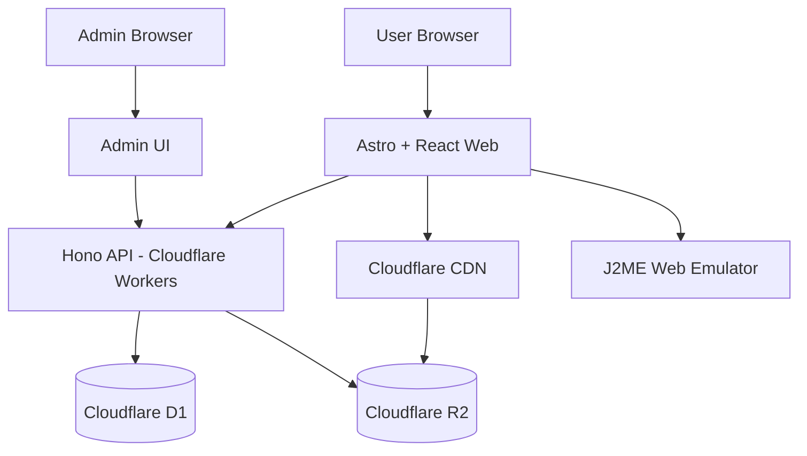
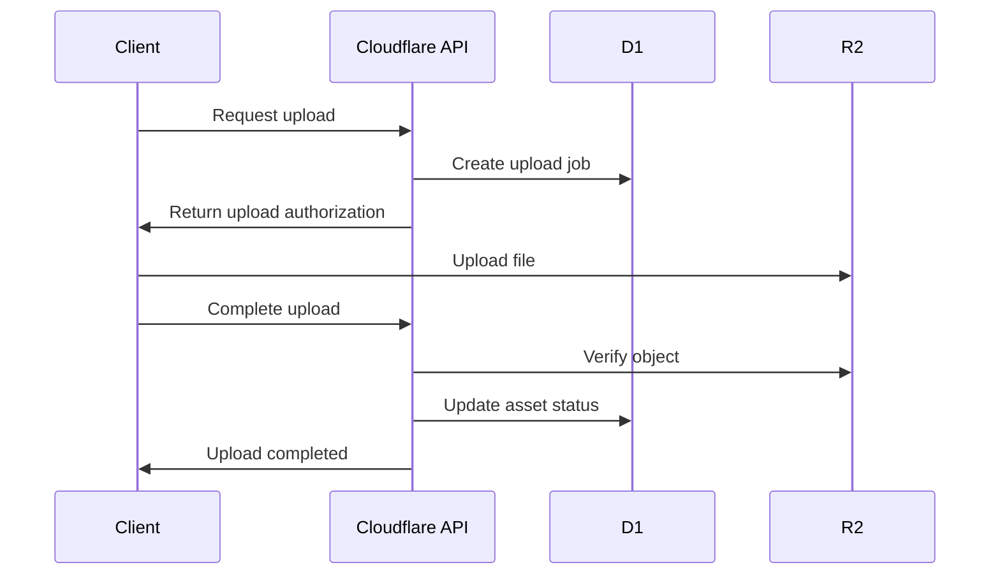
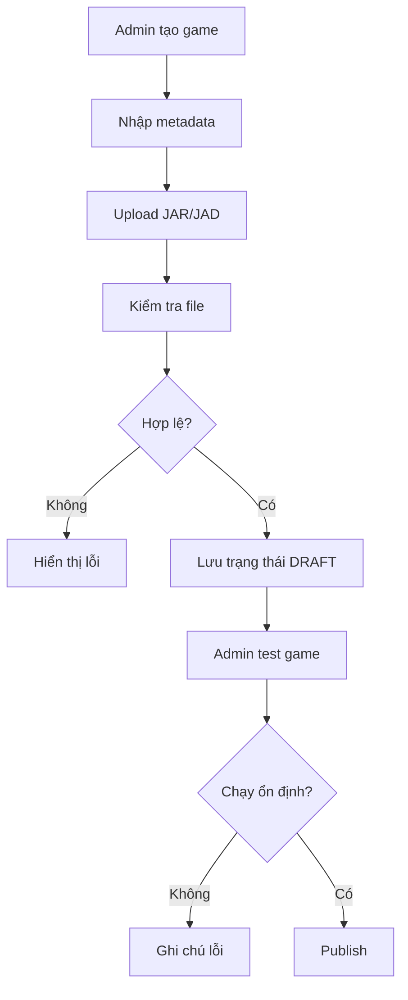

# PLAN.md --- Nền tảng Game Tuổi Thơ

> **Mục tiêu:** Xây dựng nền tảng lưu trữ, quản lý và chơi game Java ME
> (J2ME) trên trình duyệt. Ưu tiên hoàn thiện Web MVP ổn định trước,
> nhưng kiến trúc phải hỗ trợ tái sử dụng thư viện game cho Android APK
> và iOS trong tương lai.
>
> **Định hướng:** Một Game Catalog --- Một Backend --- Nhiều Client ---
> Emulator độc lập theo nền tảng.

------------------------------------------------------------------------

# 1. Tầm nhìn sản phẩm

Xây dựng một nền tảng chơi game Java trên nhiều thiết bị, tập trung ban
đầu vào các game điện thoại Nokia Java ngày trước.

Người dùng có thể:

-   Duyệt thư viện game có sẵn.
-   Tìm kiếm game theo tên, thể loại, thiết bị, nhà phát hành.
-   Xem thông tin, ảnh và mô tả game.
-   Chơi game trực tiếp trên trình duyệt.
-   Import file JAR/JAD của riêng mình.
-   Lưu trữ game đã import trong tài khoản để có thể chơi lại.
-   Quản lý danh sách game yêu thích và lịch sử chơi.
-   Tải game về thiết bị để sử dụng khi cần.

Quản trị viên có thể:

-   Upload game JAR/JAD.
-   Quản lý thông tin game, ảnh bìa, ảnh chụp màn hình.
-   Phân loại game.
-   Kiểm tra game trước khi xuất bản.
-   Quản lý game do người dùng import.
-   Quản lý trạng thái hiển thị, lưu trữ và gỡ bỏ game.
-   Theo dõi dung lượng lưu trữ và hoạt động hệ thống.

## 1.1. Định hướng đa nền tảng

Không xây dựng riêng một thư viện game cho từng nền tảng.

Tất cả nền tảng sử dụng chung:

-   Game metadata.
-   Game ID.
-   File JAR/JAD.
-   Cover và screenshot.
-   Category và tag.
-   Thông tin phiên bản.
-   Trạng thái game.
-   API và quy tắc phân quyền.

Mỗi nền tảng có emulator riêng:

  -----------------------------------------------------------------------
  Nền tảng                Emulator dự kiến        Giai đoạn
  ----------------------- ----------------------- -----------------------
  Web                     J2ME Player / FreeJ2ME  MVP
                          Web sau khi đánh giá    
                          tích hợp                

  Android APK             J2ME Loader hoặc fork   Giai đoạn 2
                          phù hợp                 

  iOS                     Nghiên cứu emulator     Giai đoạn 3
                          J2ME tương thích iOS và 
                          chính sách App Store    
  -----------------------------------------------------------------------

**Nguyên tắc:** Không lưu dữ liệu game theo định dạng riêng của
emulator. Backend quản lý file game và metadata trung lập. Client chịu
trách nhiệm tải và mở game bằng emulator tương ứng.

------------------------------------------------------------------------

# 2. Phạm vi triển khai

## 2.1. Giai đoạn MVP --- Web

Mục tiêu là có một website hoàn chỉnh, có thể triển khai thực tế và hoạt
động ổn định.

Các chức năng bắt buộc:

  Nhóm        Chức năng                          Ưu tiên
  ----------- ---------------------------------- ---------
  Website     Trang chủ, danh sách game          P0
  Website     Trang chi tiết game                P0
  Website     Tìm kiếm game                      P0
  Website     Phân loại game                     P0
  Website     Chơi game trên trình duyệt         P0
  Website     Responsive mobile/desktop          P0
  Tài khoản   Đăng ký, đăng nhập                 P0
  Tài khoản   Thư viện game cá nhân              P0
  Tài khoản   Import JAR/JAD                     P0
  Tài khoản   Xóa game đã import                 P0
  Tài khoản   Lịch sử chơi                       P1
  Quản trị    Đăng nhập quản trị                 P0
  Quản trị    Upload game                        P0
  Quản trị    CRUD game                          P0
  Quản trị    Quản lý category                   P0
  Quản trị    Quản lý cover/screenshot           P1
  Quản trị    Quản lý game người dùng import     P0
  Hệ thống    Kiểm tra file upload               P0
  Hệ thống    Quản lý file trên Object Storage   P0
  Hệ thống    Logging và monitoring              P0
  Hệ thống    SEO cơ bản                         P1

MVP chưa cần:

-   Đồng bộ save game giữa nhiều thiết bị.
-   Multiplayer.
-   Bảng xếp hạng.
-   Thành tích/Achievement.
-   Chat hoặc cộng đồng.
-   Thanh toán.
-   Social login.
-   Hệ thống đề xuất game bằng AI.
-   Ứng dụng Android/iOS.

Không mở rộng các chức năng trên trước khi Web MVP đạt tiêu chí ổn định.

## 2.2. Giai đoạn 2 --- Android APK

Tái sử dụng Backend và Game Catalog.

Chức năng dự kiến:

-   Duyệt thư viện game.
-   Tìm kiếm và xem chi tiết.
-   Download game về thiết bị.
-   Chơi game bằng emulator Android.
-   Import JAR từ bộ nhớ thiết bị.
-   Quản lý game offline.
-   Yêu thích và lịch sử chơi.
-   Cấu hình phím điều khiển.
-   Chạy màn hình ngang/dọc.
-   Quản lý save data cục bộ.

Định hướng kỹ thuật:

-   Kotlin.
-   Jetpack Compose.
-   Room.
-   DataStore.
-   Retrofit/OkHttp.
-   J2ME Loader làm nền tảng nghiên cứu tích hợp hoặc fork.

Không nên chỉ đóng gói website vào WebView để làm APK. Ứng dụng cần trải
nghiệm native và khả năng chạy game offline.

## 2.3. Giai đoạn 3 --- iOS

Nghiên cứu khả năng triển khai emulator J2ME trên iOS.

Không cam kết iOS hỗ trợ toàn bộ game JAR như Android. Cần kiểm tra:

-   Khả năng port emulator.
-   Khả năng tương thích Java ME.
-   Quy định phân phối ứng dụng của Apple.
-   Cách quản lý file game.
-   Hiệu năng và giới hạn hệ thống.
-   Cơ chế điều khiển và lưu dữ liệu.

Nếu chưa có emulator phù hợp, có thể phát triển ứng dụng iOS để duyệt
thư viện và sử dụng Web Player trong giai đoạn chuyển tiếp, nhưng phải
kiểm tra chính sách nền tảng trước khi phát hành.

------------------------------------------------------------------------

# 3. Kiến trúc tổng thể

## 3.1. Kiến trúc đề xuất

Ưu tiên Cloudflare để giảm chi phí vận hành và đơn giản hóa triển khai.

  Thành phần       Công nghệ                          Nhiệm vụ
  ---------------- ---------------------------------- -------------------------------
  Web Frontend     Astro + React + TypeScript         Website người dùng
  Admin            React + TypeScript                 Trang quản trị
  UI               Tailwind CSS                       Giao diện
  API              Hono + Cloudflare Workers          REST API
  Database         Cloudflare D1                      Metadata và dữ liệu nghiệp vụ
  Object Storage   Cloudflare R2                      JAR, JAD, ảnh, tài nguyên
  CDN              Cloudflare                         Phân phối file
  Authentication   JWT/session an toàn                Xác thực người dùng
  Web Emulator     J2ME Player / FreeJ2ME Web         Chạy game
  Monitoring       Cloudflare Logs + Error Tracking   Theo dõi hệ thống

Lưu ý: Có thể sử dụng một frontend project với hai khu vực `/` và
`/admin`, nhưng phải tách biệt layout, route, quyền truy cập và module
nghiệp vụ.

## 3.2. Sơ đồ kiến trúc



## 3.3. Phân tách domain

Đề xuất:

``` text
example.com          Website người dùng
example.com/admin    Trang quản trị
api.example.com      Backend API
cdn.example.com      Game assets và ảnh
play.example.com     Web emulator (nếu cần tách origin)
```

Emulator nên được cô lập khỏi website chính:

-   Không chia sẻ quyền truy cập quản trị.
-   Không cấp token quản trị cho emulator.
-   Không cho emulator truy cập trực tiếp database.
-   Không dùng chung cookie xác thực nhạy cảm.
-   Áp dụng iframe sandbox phù hợp.
-   Kiểm tra CSP và CORS.
-   Giới hạn quyền truy cập tài nguyên theo nhu cầu.

Việc tách origin phải được kiểm tra thực tế với emulator trước khi chốt
phương án triển khai.

------------------------------------------------------------------------

# 4. Nguyên tắc thiết kế dữ liệu đa nền tảng

Đây là phần quan trọng nhất của hệ thống.

Không được thiết kế bảng game theo kiểu mỗi game gắn với một emulator
hoặc một nền tảng cụ thể.

## 4.1. Phân biệt Game Catalog và User Library

Có hai khái niệm riêng:

**Game Catalog:** Thư viện game chung do quản trị viên quản lý và xuất
bản.

**User Library:** Thư viện cá nhân của từng người dùng, gồm các game họ
import hoặc lưu từ Catalog.

Một game trong Catalog có thể được nhiều người dùng thêm vào thư viện mà
không cần nhân bản file JAR.

Một game người dùng import mặc định là riêng tư. Không tự động đưa vào
Catalog công khai.

## 4.2. Định danh game

Mỗi game có một ID ổn định, ví dụ:

``` text
game_id: 10001
slug: ninja-school
```

Game ID không thay đổi khi cập nhật cover, mô tả hoặc phiên bản file.

Một game có thể có nhiều phiên bản JAR/JAD.

Không dùng tên file làm định danh duy nhất.

## 4.3. Database schema dự kiến

Agent có thể điều chỉnh kiểu dữ liệu và tên cột theo quy ước ORM, nhưng
phải giữ nguyên ý nghĩa nghiệp vụ.

### Bảng `users`

  Cột             Ý nghĩa
  --------------- ------------------
  id              ID người dùng
  username        Tên đăng nhập
  email           Email
  password_hash   Mật khẩu đã hash
  role            USER / ADMIN
  status          ACTIVE / BLOCKED
  created_at      Ngày tạo
  updated_at      Ngày cập nhật

### Bảng `games`

  Cột              Ý nghĩa
  ---------------- ---------------------------------------
  id               ID game
  name             Tên game
  slug             URL thân thiện SEO
  description      Mô tả
  developer        Nhà phát triển
  publisher        Nhà phát hành
  release_year     Năm phát hành
  category_id      Danh mục chính
  cover_asset_id   Ảnh bìa
  status           DRAFT / PUBLISHED / HIDDEN / ARCHIVED
  visibility       PUBLIC / PRIVATE
  source_type      ADMIN / USER_SUBMISSION
  created_by       Người tạo
  published_at     Thời gian xuất bản
  created_at       Ngày tạo
  updated_at       Ngày cập nhật

### Bảng `game_versions`

  Cột            Ý nghĩa
  -------------- --------------------
  id             ID phiên bản
  game_id        Game sở hữu
  version_name   Tên phiên bản
  jar_asset_id   File JAR
  jad_asset_id   File JAD, nullable
  jar_sha256     SHA-256
  jad_sha256     SHA-256, nullable
  file_size      Dung lượng
  status         ACTIVE / INACTIVE
  created_at     Ngày tạo

### Bảng `categories`

  Cột           Ý nghĩa
  ------------- -------------------
  id            ID danh mục
  name          Tên danh mục
  slug          Slug
  description   Mô tả
  sort_order    Thứ tự
  status        ACTIVE / INACTIVE

### Bảng `game_assets`

Quản lý tất cả file lưu trên R2.

  Cột                 Ý nghĩa
  ------------------- --------------------------------------------
  id                  ID asset
  owner_user_id       Chủ sở hữu, nullable
  asset_type          JAR / JAD / COVER / SCREENSHOT
  storage_key         Key trên R2
  original_filename   Tên file ban đầu
  mime_type           MIME
  file_size           Dung lượng
  sha256              Hash
  status              UPLOADING / ACTIVE / QUARANTINED / DELETED
  created_at          Ngày tạo

### Bảng `user_library`

  Cột               Ý nghĩa
  ----------------- --------------------------------
  id                ID
  user_id           Chủ sở hữu
  game_id           Game Catalog, nullable
  game_version_id   Phiên bản, nullable
  custom_asset_id   Asset do user import, nullable
  custom_name       Tên game người dùng đặt
  source_type       CATALOG / IMPORT
  created_at        Ngày thêm

Ràng buộc nghiệp vụ:

-   Một bản ghi chỉ được tham chiếu Catalog hoặc asset import riêng.
-   Không để một bản ghi vừa có `game_version_id` vừa có
    `custom_asset_id`.
-   Có unique constraint phù hợp để tránh thêm trùng cùng game vào thư
    viện.
-   User chỉ được truy cập bản ghi và asset thuộc quyền sở hữu của họ.

### Bảng `game_screenshots`

  Cột          Ý nghĩa
  ------------ ---------
  id           ID
  game_id      Game
  asset_id     Ảnh
  sort_order   Thứ tự

### Bảng `user_game_activity`

  Cột               Ý nghĩa
  ----------------- ------------------------
  id                ID
  user_id           Người dùng
  game_id           Game Catalog, nullable
  user_library_id   Game cá nhân, nullable
  activity_type     PLAY / FAVORITE
  last_played_at    Lần chơi gần nhất
  play_count        Số lượt chơi

### Bảng `upload_jobs`

Theo dõi upload và xử lý file:

  Cột             Ý nghĩa
  --------------- -------------------------------------------
  id              ID
  user_id         Người upload
  asset_id        Asset
  status          PENDING / PROCESSING / COMPLETED / FAILED
  error_message   Lỗi
  created_at      Ngày tạo
  updated_at      Ngày cập nhật

Có thể bổ sung bảng `audit_logs` để lưu lại hành động quản trị quan
trọng.

## 4.4. Quy tắc lưu trữ

Game Catalog:

``` text
games/{game_id}/versions/{version_id}/game.jar
games/{game_id}/versions/{version_id}/game.jad
games/{game_id}/covers/cover.webp
games/{game_id}/screenshots/01.webp
```

User import:

``` text
users/{user_id}/imports/{asset_id}/game.jar
users/{user_id}/imports/{asset_id}/game.jad
```

Không sử dụng tên file gốc làm storage key.

Lưu ý:

-   R2 là nơi lưu file thực tế.
-   D1 chỉ lưu metadata và storage key.
-   Không lưu file JAR trực tiếp vào D1.
-   Không lưu file binary dưới dạng Base64 trong database.
-   Dùng SHA-256 để kiểm tra toàn vẹn và phát hiện file trùng.
-   Không tự ý xóa asset đang được tham chiếu.
-   Khi xóa game hoặc user import, xử lý tham chiếu trước rồi mới xóa
    file.
-   Có cơ chế dọn file upload thất bại hoặc file không còn được tham
    chiếu.

## 4.5. Tương lai hỗ trợ đa nền tảng

Metadata game không chứa trạng thái phụ thuộc vào emulator.

Nếu cần khai báo khả năng tương thích, bổ sung bảng:

`game_compatibility`

  Cột                    Ý nghĩa
  ---------------------- ----------------------------------------
  id                     ID
  game_version_id        Phiên bản game
  platform               WEB / ANDROID / IOS
  emulator_id            Emulator
  compatibility_status   TESTED / PARTIAL / NOT_TESTED / FAILED
  notes                  Ghi chú
  tested_at              Ngày kiểm tra

Không bắt buộc tạo bảng này ngay từ MVP nếu chưa có nhu cầu hiển thị.
Tuy nhiên, phải giữ thiết kế mở để bổ sung mà không phải thay đổi cấu
trúc cốt lõi.

------------------------------------------------------------------------

# 5. Thiết kế Backend API

API phải độc lập với frontend và emulator.

Ưu tiên REST API, JSON, version prefix `/api/v1`.

## 5.1. Public API

``` http
GET    /api/v1/games
GET    /api/v1/games/:slug
GET    /api/v1/games/:id/versions
GET    /api/v1/categories
GET    /api/v1/categories/:slug/games
GET    /api/v1/search?q=
```

Hỗ trợ:

-   Pagination.
-   Search.
-   Filter category.
-   Sort theo mới nhất, phổ biến.
-   Chỉ trả game PUBLISHED và PUBLIC.
-   Cache các endpoint công khai phù hợp.

## 5.2. Authentication API

``` http
POST   /api/v1/auth/register
POST   /api/v1/auth/login
POST   /api/v1/auth/logout
GET    /api/v1/auth/me
```

## 5.3. User Library API

``` http
GET    /api/v1/me/library
POST   /api/v1/me/library
DELETE /api/v1/me/library/:id

GET    /api/v1/me/imports
POST   /api/v1/me/imports
DELETE /api/v1/me/imports/:id

GET    /api/v1/me/favorites
POST   /api/v1/me/favorites
DELETE /api/v1/me/favorites/:game_id

GET    /api/v1/me/history
POST   /api/v1/me/history
```

## 5.4. Upload API

Không upload file lớn qua Worker nếu có thể upload trực tiếp lên R2.

Luồng đề xuất:



Agent cần chọn cơ chế upload thực tế phù hợp với Cloudflare R2, ví dụ
presigned URL hoặc multipart upload khi cần.

Không được tin dữ liệu do client gửi về như kích thước, MIME, hash nếu
chưa xác minh.

## 5.5. Admin API

``` http
GET    /api/v1/admin/games
POST   /api/v1/admin/games
PUT    /api/v1/admin/games/:id
DELETE /api/v1/admin/games/:id

POST   /api/v1/admin/games/:id/publish
POST   /api/v1/admin/games/:id/hide

POST   /api/v1/admin/games/:id/versions
DELETE /api/v1/admin/versions/:id

GET    /api/v1/admin/categories
POST   /api/v1/admin/categories
PUT    /api/v1/admin/categories/:id
DELETE /api/v1/admin/categories/:id

GET    /api/v1/admin/imports
GET    /api/v1/admin/assets
DELETE /api/v1/admin/assets/:id
```

Tất cả endpoint `/admin` phải kiểm tra role phía server. Không chỉ ẩn
nút hoặc trang trên frontend.

------------------------------------------------------------------------

# 6. Thiết kế Website

## 6.1. Phong cách giao diện

Tham khảo trải nghiệm của Game Tuổi Thơ, nhưng xây dựng UI riêng hiện
đại hơn.

Định hướng:

-   Nostalgia, gợi nhớ điện thoại Nokia.
-   Pixel-art có chọn lọc.
-   Màu sắc vui tươi, dễ nhìn.
-   Game cover nổi bật.
-   Responsive.
-   Mobile-first.
-   Không lạm dụng animation.
-   Ưu tiên tốc độ tải trang.

## 6.2. Các trang người dùng

### Trang chủ `/`

-   Header.
-   Logo.
-   Thanh tìm kiếm.
-   Menu danh mục.
-   Game nổi bật.
-   Game mới thêm.
-   Game phổ biến.
-   Game theo thể loại.
-   Footer.

### Trang danh sách `/games`

-   Danh sách game dạng grid.
-   Tìm kiếm.
-   Lọc category.
-   Sắp xếp.
-   Pagination.

### Trang chi tiết `/game/:slug`

-   Cover.
-   Tên game.
-   Mô tả.
-   Thông tin game.
-   Ảnh screenshot.
-   Phiên bản.
-   Nút chơi ngay.
-   Nút thêm vào thư viện.
-   Game liên quan.

### Trang chơi `/play/:slug`

-   Khu vực emulator.
-   Chọn phiên bản nếu có nhiều phiên bản.
-   Fullscreen.
-   Hướng dẫn điều khiển.
-   Tùy chọn phím bấm.
-   Thông báo lỗi nếu game không tương thích.

### Tài khoản

``` text
/login
/register
/me/library
/me/imports
/me/favorites
/me/history
/me/settings
```

## 6.3. Trang quản trị `/admin`

Thiết kế riêng, không dùng chung layout với website người dùng.

Các module:

``` text
/admin
/admin/games
/admin/games/create
/admin/games/:id
/admin/categories
/admin/uploads
/admin/user-imports
/admin/users
/admin/storage
/admin/settings
/admin/logs
```

### Dashboard

Hiển thị:

-   Tổng game Catalog.
-   Tổng game đã xuất bản.
-   Tổng game đang chờ duyệt.
-   Tổng user.
-   Tổng lượt import.
-   Tổng dung lượng R2.
-   Upload lỗi.
-   Game được chơi nhiều.

### Quản lý game

Các thao tác:

-   Tạo game.
-   Sửa thông tin.
-   Upload JAR.
-   Upload JAD.
-   Upload cover.
-   Upload screenshot.
-   Thêm phiên bản.
-   Xem trước thông tin.
-   Test game.
-   Publish.
-   Ẩn game.
-   Archive game.

### Quy trình upload game



Không tự động xuất bản game ngay khi upload.

### Quản lý game người dùng import

Admin có thể:

-   Xem danh sách import.
-   Xem người sở hữu.
-   Xem tên file, dung lượng, hash.
-   Xem trạng thái kiểm tra.
-   Xóa file vi phạm hoặc file lỗi.
-   Thống kê dung lượng theo user.

**Nguyên tắc quyền riêng tư:** Game user import mặc định PRIVATE. Admin
có quyền quản trị theo chính sách hệ thống nhưng không biến game đó
thành game công khai nếu chưa có sự đồng ý và kiểm tra quyền phân phối.

------------------------------------------------------------------------

# 7. Tích hợp Web Emulator

## 7.1. Đánh giá emulator

Ưu tiên nghiên cứu các dự án:

-   J2ME Player: https://github.com/iqbaladinur/j2me-player
-   FreeJ2ME Web: https://github.com/zb3/freej2me-web
-   J2ME On Web: https://github.com/L1games/J2ME-On-Web

Không được bắt đầu xây emulator từ đầu.

Agent phải nghiên cứu:

1.  License của dự án.
2.  Khả năng tích hợp vào website.
3.  Khả năng truyền file JAR/JAD.
4.  Cách khởi tạo game.
5.  Cách điều khiển phím.
6.  Hỗ trợ âm thanh.
7.  Hỗ trợ game 2D/3D.
8.  Hỗ trợ lưu RMS.
9.  Cách quản lý phiên chơi.
10. Khả năng chạy trên Chrome, Firefox, Edge và mobile browser.
11. Cách đóng gói và deploy độc lập.
12. Các giới hạn về hiệu năng và tương thích.

Đặc biệt, nếu sử dụng J2ME Player cần kiểm tra kỹ điều kiện sử dụng
CheerpJ, license GPL-3.0 của dự án và các dependency. Không mặc định
rằng có thể dùng thương mại hoặc phân phối runtime mà không phát sinh
nghĩa vụ license.

## 7.2. Yêu cầu tích hợp

Tạo một adapter riêng để frontend không phụ thuộc trực tiếp vào
implementation của emulator.

Ví dụ interface:

``` typescript
interface GameEmulator {
  initialize(container: HTMLElement): Promise<void>;

  loadGame(input: {
    jarUrl: string;
    jadUrl?: string;
    gameId?: string;
    versionId?: string;
  }): Promise<void>;

  start(): Promise<void>;

  pause(): Promise<void>;

  resume(): Promise<void>;

  stop(): Promise<void>;

  setKey(key: string, pressed: boolean): void;

  enterFullscreen(): Promise<void>;

  destroy(): Promise<void>;
}
```

Đây là contract định hướng, cần điều chỉnh theo khả năng thực tế của
emulator được chọn.

Không giả định emulator hỗ trợ đầy đủ những method trên. Adapter có thể
trả về lỗi `NOT_SUPPORTED` cho tính năng chưa được hỗ trợ.

## 7.3. Luồng chơi game

``` text
User mở trang chơi
    |
Frontend lấy game metadata từ API
    |
Lấy phiên bản game
    |
Lấy URL JAR/JAD hợp lệ
    |
Khởi tạo emulator
    |
Nạp game
    |
User chơi
    |
Gửi sự kiện PLAY/history về API
    |
Kết thúc phiên chơi
```

Không truyền thông tin đăng nhập hoặc token quản trị vào emulator.

## 7.4. Kiểm thử emulator

Không được đánh giá emulator chỉ bằng một game.

Chuẩn bị bộ game kiểm thử gồm:

-   Game 2D đơn giản.
-   Game có âm thanh MIDI.
-   Game có màn hình ngang.
-   Game có màn hình dọc.
-   Game dùng keypad nhiều phím.
-   Game có menu và lưu dữ liệu.
-   Game có đồ họa hoặc hiệu ứng phức tạp.
-   Một số game 3D nếu emulator tuyên bố hỗ trợ.

Lập bảng compatibility để ghi lại:

-   Tên game.
-   Phiên bản JAR.
-   Emulator version.
-   Trình duyệt.
-   Kết quả khởi chạy.
-   Đồ họa.
-   Âm thanh.
-   Điều khiển.
-   Lưu dữ liệu.
-   Lỗi đã biết.

------------------------------------------------------------------------

# 8. Bảo mật và an toàn file

File JAR là dữ liệu không đáng tin cậy. Không được thực thi file JAR
trên server.

## 8.1. Kiểm tra file upload

-   Giới hạn dung lượng.
-   Chỉ nhận định dạng cho phép.
-   Kiểm tra ZIP/JAR signature và cấu trúc archive.
-   Kiểm tra file JAD.
-   Kiểm tra tên file và path traversal.
-   Chống ZIP bomb.
-   Giới hạn số lượng entry và kích thước giải nén.
-   Kiểm tra SHA-256.
-   Không tin MIME do client gửi.
-   Không cho phép upload ghi đè storage key.
-   Có trạng thái quarantine nếu kiểm tra thất bại.

Không cần giải nén toàn bộ file vào bộ nhớ. Xử lý theo luồng hoặc giới
hạn tài nguyên phù hợp.

## 8.2. Quyền truy cập

-   User chỉ xem và xóa game import của mình.
-   User không được sửa game Catalog.
-   Admin có quyền quản lý Catalog.
-   Các thao tác publish/hide/delete cần kiểm tra role.
-   Không để lộ storage key nội bộ.
-   Không để URL upload tồn tại lâu hơn cần thiết.
-   Giới hạn số lượng upload và dung lượng theo user.
-   Áp dụng rate limit cho endpoint nhạy cảm.

## 8.3. Emulator isolation

-   Tách origin nếu phù hợp.
-   Dùng iframe sandbox với các quyền tối thiểu.
-   Kiểm soát postMessage theo origin.
-   Không cấp quyền truy cập API admin.
-   Không chia sẻ session cookie không cần thiết.
-   Không cho nội dung game truy cập trái phép dữ liệu website.
-   Không tin cậy dữ liệu trả về từ emulator.

## 8.4. Bảo vệ dữ liệu người dùng

-   Hash mật khẩu bằng thuật toán phù hợp.
-   Không log password, token hoặc dữ liệu nhạy cảm.
-   Có cơ chế logout/revoke session.
-   Kiểm soát CORS.
-   Kiểm tra quyền ở server cho mọi tài nguyên riêng tư.

------------------------------------------------------------------------

# 9. UX và hiệu năng

## 9.1. Website

-   SSR hoặc prerender cho các trang game để hỗ trợ SEO.
-   Lazy load ảnh.
-   Dùng WebP/AVIF cho ảnh.
-   Pagination thay vì tải toàn bộ game.
-   Cache API public.
-   Cache cover và screenshot dài hạn với versioned URL.
-   Tránh tải emulator trước khi user mở trang chơi.
-   Không preload file JAR dung lượng lớn khi user chỉ xem trang chi
    tiết.

## 9.2. Game Player

-   Có trạng thái Loading.
-   Có trạng thái Emulator Error.
-   Có nút thử lại.
-   Có nút fullscreen.
-   Có điều khiển bằng bàn phím.
-   Có keypad ảo cho mobile.
-   Không khóa trình duyệt nếu game lỗi.
-   Có nút thoát về trang chi tiết.
-   Có hướng dẫn bật âm thanh nếu cần.

## 9.3. Storage

-   Cover và screenshot được tối ưu.
-   JAR/JAD không tự ý chuyển đổi hoặc sửa nội dung.
-   Có chính sách xóa file mồ côi.
-   Theo dõi dung lượng.
-   Có quota cho user import.
-   Có cảnh báo khi gần chạm giới hạn.

------------------------------------------------------------------------

# 10. Cấu trúc source code

Đề xuất monorepo:

``` text
game-tuoi-tho/
│
├── apps/
│   ├── web/
│   │   ├── src/
│   │   │   ├── pages/
│   │   │   ├── components/
│   │   │   ├── layouts/
│   │   │   ├── features/
│   │   │   │   ├── games/
│   │   │   │   ├── player/
│   │   │   │   ├── auth/
│   │   │   │   ├── library/
│   │   │   │   └── admin/
│   │   │   └── lib/
│   │   └── package.json
│   │
│   ├── api/
│   │   ├── src/
│   │   │   ├── routes/
│   │   │   ├── services/
│   │   │   ├── repositories/
│   │   │   ├── middleware/
│   │   │   ├── validators/
│   │   │   ├── storage/
│   │   │   └── index.ts
│   │   └── wrangler.toml
│   │
│   └── emulator-web/
│       └── README.md
│
├── packages/
│   ├── shared-types/
│   ├── api-contracts/
│   └── shared-utils/
│
├── database/
│   ├── migrations/
│   └── seeds/
│
├── docs/
│   ├── architecture.md
│   ├── database.md
│   ├── emulator-integration.md
│   ├── deployment.md
│   └── security.md
│
├── scripts/
├── tests/
├── AGENTS.md
├── PLAN.md
└── README.md
```

Không cần tạo module Android ngay trong MVP. Khi bắt đầu Android, bổ
sung:

``` text
apps/android/
    app/
    core/
    data/
    feature/
```

Không cố chia sẻ code TypeScript trực tiếp với Kotlin. Chỉ chia sẻ API
contract, JSON format và quy tắc nghiệp vụ.

------------------------------------------------------------------------

# 11. Kế hoạch thực hiện chi tiết

## Phase 0 --- Khảo sát và Proof of Concept

**Mục tiêu:** Xác định emulator có thể chạy ổn định trên trình duyệt
trước khi xây toàn bộ hệ thống.

Công việc:

1.  Clone các emulator ứng viên.
2.  Đọc license và dependency.
3.  Build thử trên môi trường local.
4.  Chạy thử ít nhất 10 game JAR đại diện.
5.  Kiểm tra âm thanh, đồ họa, keypad, fullscreen.
6.  Kiểm tra cách truyền JAR vào emulator.
7.  Kiểm tra cách chạy trên mobile browser.
8.  Kiểm tra cách lưu RMS.
9.  Kiểm tra việc nhúng emulator vào website.
10. Viết báo cáo lựa chọn emulator.

Deliverables:

-   `docs/emulator-integration.md`
-   POC chạy được trên local.
-   Danh sách game test.
-   Compatibility report.
-   Kết luận emulator được chọn.
-   Các giới hạn và rủi ro license.

**Gate:** Không chuyển sang tích hợp chính thức nếu chưa chứng minh được
cách tải và chạy game từ URL hoặc file local một cách ổn định.

## Phase 1 --- Khởi tạo nền tảng

1.  Khởi tạo monorepo.
2.  Cấu hình TypeScript.
3.  Cấu hình lint và format.
4.  Khởi tạo Astro + React.
5.  Khởi tạo Hono Worker.
6.  Tạo D1 database.
7.  Tạo R2 bucket.
8.  Cấu hình biến môi trường.
9.  Cấu hình local development.
10. Cấu hình staging và production.
11. Viết health check.
12. Thiết lập migration.
13. Viết CI cơ bản.

Deliverables:

-   Website chạy local.
-   API chạy local.
-   Database migration.
-   R2 upload/download thử nghiệm.
-   CI pass.

## Phase 2 --- Database và Backend Core

1.  Thiết kế và tạo migration.
2.  Xây repository layer.
3.  Xây service layer.
4.  Xây validation.
5.  Xây error handling thống nhất.
6.  Xây authentication.
7.  Xây authorization.
8.  Xây public game API.
9.  Xây category API.
10. Xây user library API.
11. Xây upload API.
12. Xây admin API.
13. Xây audit log cho hành động quan trọng.

Deliverables:

-   API hoàn chỉnh theo `/api/v1`.
-   OpenAPI hoặc tài liệu API.
-   Unit test service.
-   Integration test endpoint.
-   Kiểm tra quyền truy cập.

## Phase 3 --- Website người dùng

1.  Thiết kế design system.
2.  Xây header/footer.
3.  Xây trang chủ.
4.  Xây trang danh sách game.
5.  Xây tìm kiếm.
6.  Xây filter category.
7.  Xây trang chi tiết.
8.  Xây trang đăng nhập.
9.  Xây trang đăng ký.
10. Xây thư viện cá nhân.
11. Xây trang import game.
12. Xây trang lịch sử.
13. Tối ưu responsive.
14. Tối ưu SEO.

Deliverables:

-   Website hoàn chỉnh về luồng duyệt và quản lý game.
-   Responsive desktop/mobile.
-   Không sử dụng dữ liệu hardcode trong production.
-   Kết nối API thực tế.

## Phase 4 --- Trang quản trị

1.  Admin login và phân quyền.
2.  Dashboard.
3.  Danh sách game.
4.  Tạo game.
5.  Sửa game.
6.  Upload JAR/JAD.
7.  Upload cover/screenshot.
8.  Quản lý version.
9.  Test và publish game.
10. Quản lý category.
11. Danh sách user imports.
12. Quản lý asset.
13. Theo dõi upload lỗi.
14. Theo dõi dung lượng.

Deliverables:

-   Admin có thể quản lý Catalog hoàn toàn.
-   Admin có thể quản lý file import của user theo chính sách.
-   Game chưa publish không xuất hiện ở public API.

## Phase 5 --- Tích hợp Emulator

1.  Đóng gói emulator độc lập.
2.  Xây adapter.
3.  Xây player page.
4.  Tích hợp tải JAR/JAD.
5.  Tích hợp keyboard.
6.  Tích hợp keypad ảo.
7.  Tích hợp fullscreen.
8.  Tích hợp âm thanh.
9.  Xử lý lỗi.
10. Gửi lịch sử chơi.
11. Kiểm thử compatibility.
12. Kiểm thử trên nhiều trình duyệt.

Deliverables:

-   User chơi được game Catalog.
-   User chơi được game import.
-   Có thông báo lỗi rõ ràng.
-   Có danh sách game tương thích.

## Phase 6 --- Kiểm thử và tối ưu

Kiểm thử:

-   Đăng ký và đăng nhập.
-   Phân quyền.
-   Upload file hợp lệ.
-   Upload file không hợp lệ.
-   Upload file lớn.
-   Upload trùng.
-   User truy cập asset của người khác.
-   Admin publish/hide game.
-   Xóa game có version.
-   Xóa asset đang được tham chiếu.
-   Emulator khởi chạy.
-   Emulator lỗi giữa phiên.
-   Responsive mobile.
-   SEO.
-   Cache.
-   CDN.
-   Rate limit.
-   R2 storage.
-   Database migration.

Thực hiện kiểm thử tải phù hợp với quy mô dự kiến và đo:

-   API latency.
-   Tỷ lệ lỗi API.
-   Tốc độ tải cover.
-   Tốc độ tải JAR.
-   Thời gian khởi chạy emulator.
-   Tỷ lệ game chạy thành công trên bộ test.

## Phase 7 --- Deploy MVP

1.  Tạo production database.
2.  Tạo production R2 bucket.
3.  Cấu hình secrets.
4.  Cấu hình domain.
5.  Cấu hình CDN.
6.  Deploy API.
7.  Deploy Web.
8.  Deploy emulator.
9.  Chạy migration production.
10. Tạo tài khoản admin ban đầu an toàn.
11. Import dữ liệu game mẫu có quyền phân phối.
12. Kiểm tra production smoke test.
13. Bật logging.
14. Kiểm tra backup và quy trình khôi phục.
15. Viết hướng dẫn vận hành.

Deliverables:

-   Website production.
-   Admin production.
-   API production.
-   Emulator production.
-   Tài liệu deployment.
-   Tài liệu vận hành.

------------------------------------------------------------------------

# 12. Tiêu chí nghiệm thu MVP

Không coi MVP hoàn thành chỉ vì website chạy được trên local.

## 12.1. Chức năng

-   [ ] User đăng ký/đăng nhập được.
-   [ ] User xem danh sách game.
-   [ ] User tìm kiếm game.
-   [ ] User lọc category.
-   [ ] User xem chi tiết game.
-   [ ] User chơi được game tương thích trên Web.
-   [ ] User import JAR/JAD.
-   [ ] User quản lý thư viện riêng.
-   [ ] User không truy cập được game riêng của người khác.
-   [ ] Admin upload game.
-   [ ] Admin sửa thông tin game.
-   [ ] Admin quản lý version.
-   [ ] Admin publish/hide game.
-   [ ] Admin quản lý category.
-   [ ] Admin xem và xử lý user imports.
-   [ ] Game private không xuất hiện trong public API.

## 12.2. Kỹ thuật

-   [ ] Database migration chạy được.
-   [ ] API có validation.
-   [ ] Có authentication và authorization.
-   [ ] Upload có kiểm tra file.
-   [ ] Có giới hạn dung lượng.
-   [ ] Không thực thi JAR trên server.
-   [ ] Không lưu JAR trong D1.
-   [ ] Có logging.
-   [ ] Có xử lý lỗi.
-   [ ] Có CI cơ bản.
-   [ ] Có hướng dẫn deploy.
-   [ ] Có smoke test production.

## 12.3. Độ ổn định

Đặt mục tiêu ban đầu:

-   API public có tỷ lệ lỗi thấp trong kiểm thử.
-   Không phát sinh lỗi phân quyền nghiêm trọng.
-   Upload file không gây crash Worker.
-   Các game thuộc bộ test đã được ghi nhận kết quả tương thích.
-   Không để lỗi emulator làm treo toàn bộ website.
-   Không có file upload thất bại bị công khai.
-   Có khả năng khôi phục metadata và file từ quy trình backup phù hợp.

Không cam kết tất cả game Java đều chạy được. Phải công khai trạng thái
tương thích theo từng game/phiên bản khi có dữ liệu kiểm thử.

------------------------------------------------------------------------

# 13. Quản lý dữ liệu game và bản quyền

Game Java cũ không đồng nghĩa với game đã hết bản quyền.

Quy tắc:

-   Chỉ công khai game có quyền phân phối hoặc có giấy phép phù hợp.
-   Không tự động lấy và rehost game từ website khác.
-   Game người dùng import chỉ lưu riêng tư.
-   Có quy trình tiếp nhận yêu cầu gỡ bỏ nội dung.
-   Lưu nguồn gốc và thông tin giấy phép khi có.
-   Có thể bổ sung trường `license_type`, `source_url`, `rights_note`
    trong Catalog.
-   Không công khai game import của user nếu chưa được cho phép.

------------------------------------------------------------------------

# 14. Chuẩn code và nguyên tắc dành cho Agent

Agent phải tuân thủ các quy tắc:

1.  Đọc toàn bộ `PLAN.md` trước khi triển khai.
2.  Đọc `AGENTS.md` nếu tồn tại.
3.  Không tự ý thay đổi stack đã thống nhất.
4.  Không xây emulator từ đầu.
5.  Không trộn logic emulator vào business logic.
6.  Không trộn user import vào public Catalog.
7.  Không lưu binary game trong database.
8.  Không hardcode URL file game.
9.  Không hardcode dữ liệu game trong frontend.
10. Không bỏ qua authentication/authorization.
11. Không tin dữ liệu file từ client.
12. Không publish game tự động.
13. Không tạo API riêng cho Android khi API dùng chung đã đáp ứng.
14. Không tạo database riêng cho từng nền tảng.
15. Không phát triển Android/iOS trước khi Web MVP đạt tiêu chí nghiệm
    thu.
16. Không thêm dependency nếu chưa đánh giá lợi ích và license.
17. Ưu tiên code đơn giản, dễ bảo trì.
18. Có test cho logic quan trọng.
19. Mọi migration phải có thể kiểm soát và review.
20. Cập nhật tài liệu khi thay đổi kiến trúc.

## 14.1. Cách Agent triển khai

Không yêu cầu Agent sinh toàn bộ dự án trong một lần.

Thực hiện theo từng Phase:

-   Đọc yêu cầu.
-   Phân tích repository hiện tại.
-   Đề xuất kế hoạch cho Phase.
-   Triển khai từng nhóm chức năng.
-   Chạy test.
-   Kiểm tra lỗi.
-   Cập nhật tài liệu.
-   Báo cáo kết quả.
-   Chờ xác nhận trước khi chuyển Phase có rủi ro lớn.

Sau mỗi Phase, báo cáo:

``` text
Phase:
Đã hoàn thành:
File đã tạo/sửa:
Database migration:
API đã triển khai:
Test đã chạy:
Kết quả:
Vấn đề còn tồn tại:
Rủi ro:
Việc tiếp theo:
```

Nếu có quyết định kiến trúc quan trọng chưa được xác định, Agent phải
báo cáo và đưa ra lựa chọn trước khi tự ý triển khai.

------------------------------------------------------------------------

# 15. Thứ tự ưu tiên cuối cùng

  Thứ tự   Hạng mục             Mục tiêu
  -------- -------------------- --------------------------------------
  1        Emulator POC         Chứng minh Web có thể chạy game
  2        Backend + Database   Nền tảng dữ liệu dùng chung
  3        Web Game Catalog     Duyệt và tìm game
  4        Admin                Quản lý game và upload
  5        User Import          Lưu trữ game riêng tư
  6        Web Player           Chơi game ổn định
  7        Testing + Deploy     Hoàn thiện MVP
  8        Android APK          Dùng lại Catalog và API
  9        iOS                  Nghiên cứu và triển khai khi khả thi

**Ưu tiên quan trọng:** Web MVP phải là sản phẩm có thể sử dụng thực tế,
không phải bản demo. Tuy nhiên, các quyết định về Game ID, Game Version,
Asset Storage, User Library và API phải được thiết kế ngay từ đầu để
Android và iOS có thể dùng chung dữ liệu mà không phải xây dựng lại hệ
thống quản lý game.

------------------------------------------------------------------------

# 16. Định nghĩa hoàn thành dự án MVP

MVP được xem là hoàn thành khi:

1.  Người dùng có thể truy cập website và duyệt thư viện game.
2.  Người dùng có thể chơi game trực tiếp trên trình duyệt với các game
    đã kiểm thử tương thích.
3.  Người dùng có thể import JAR/JAD và lưu trữ trong tài khoản.
4.  Người dùng có thể quản lý thư viện riêng.
5.  Quản trị viên có thể upload, kiểm tra, chỉnh sửa và xuất bản game.
6.  Quản trị viên có thể quản lý game người dùng import.
7.  Backend và database không phụ thuộc vào emulator.
8.  Game metadata và file có thể được sử dụng lại bởi Android/iOS.
9.  Website đã được deploy production, có logging, kiểm thử và tài liệu
    vận hành.

**Kết quả cuối cùng:** Một nền tảng quản lý và phân phối game J2ME độc
lập với nền tảng chạy game, trong đó Web là client đầu tiên, Android và
iOS là các client có thể phát triển tiếp mà không cần xây dựng lại Game
Catalog hoặc Backend.
